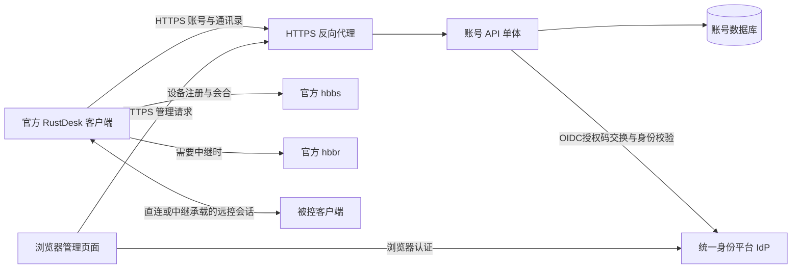

> 历史讨论稿：2026-11-03整理时保留。本文包含早期候选设计和当时验收范围，不作为当前维护依据。当前结构见[技术架构](architecture.md)，已采用决策见[技术路线](technical-route.md)。

# 技术架构讨论稿

- 版本：0.10，初稿2026-10-30，更新2026-10-31。
- `document_status: drafted`；`account_service_status: m23_verified`。
- 负责人及确认人：项目发起人；起草：Codex。
- 约束与需求唯一来源：[PRD](PRD.md)；源码与外部来源：[调研记录](research.md)。已确认以Rust独立开发轻量服务，其余未确认的架构选择仍为建议。
- 实例事实：已按E-16在amd64服务器复用Traefik和同宿主共享PG，使用独立应用库、暂不启用OIDC；配置、指纹和运行证据见[部署记录](deployment-2026-10-31.md)。

## 1. 建议的系统边界

采用模块化单体：一个账号 API 服务、一个数据库、一套静态 Web 管理页面，配合既有官方 OSS `hbbs` / `hbbr`。首期单实例，无微服务拆分、消息队列或 Redis 硬依赖。



API 只处理账号和业务数据，不承载屏幕、键鼠、文件传输数据。账号数据库独立于 `hbbs` 的 SQLite，禁止依赖直接改写官方服务端内部表。API 故障是否影响已有远控会话，属于联调验收项。

### 模块与依赖方向

| 模块 | 职责 | 约束 |
|---|---|---|
| RustDesk 兼容适配 | 客户端固定路径、请求/响应 DTO、状态码、协议回退 | 不套管理 API 的统一响应包裹；以客户端解析行为为准 |
| 管理 API | Web 管理、账号开通/停用/重置、个人设置 | 使用独立路由命名空间，版本化建议 `/admin/api/v1` |
| 身份与会话 | 本地/OIDC认证、自动建档、身份/角色映射、密码散列、会话有效性与撤销 | 兼容层和管理端复用业务规则；IdP凭据与本服务token分开 |
| 通讯录 | 个人通讯录、联系人、别名、标签、同步 | 所有查询以认证用户限制归属 |
| 审计与运维 | 账号事件、健康检查、迁移、备份恢复 | 账号审计与远控会话审计分别定义 |
| 持久化 | 事务、唯一约束、数据迁移 | 领域逻辑不依赖 HTTP DTO |

## 2. Rust技术栈与方案比较

用户已确认后端采用Rust（E-10）。以下保留前期比较依据，Go和Java不再作为待选后端语言。维护与开发成本为工程判断（`inference`），没有实测性能或人日依据。

| 方案 | 针对本项目的优势 | 主要成本 | 适用条件 |
|---|---|---|---|
| Go + Gin + GORM | 已拉取同组合的 MIT API 参考；账号及管理功能参考较完整；可采用单服务部署 | 需要审查旧依赖、会话实现和过宽功能；与当前官方客户端仍需逐项验证 | 重视尽快形成可用首版，团队没有更强语言偏好 |
| Rust + Axum + SQLx | 适合独立模块化服务；可使用 Rust 类型与错误模型；存在社区 Rust 参考实现 | 兼容层、管理集成与迁移仍需自行交付；Rust 异步开发熟悉度影响成本 | 团队熟悉 Rust，愿意承担初始建设成本 |
| Java + Spring Boot | 账号、安全、运维生态丰富，适合现有 Java 团队维护 | 需要独立对接 RustDesk 协议；轻量自托管的部署成本需评估 | Java 是团队主要维护语言 |

框架出处：[Gin](https://gin-gonic.com/en/docs/)、[GORM](https://gorm.io/docs/)、[Axum](https://github.com/tokio-rs/axum)、[SQLx](https://github.com/transact-rs/sqlx)、[Spring Boot](https://docs.spring.io/spring-boot/index.html)。这些链接用于确认框架能力和定位，不构成依赖版本锁定。

**用户已要求按推荐采用Rust + Tokio + Axum + SQLx（E-13）**：Tokio提供异步运行时，Axum承担HTTP路由和适配，SQLx承担SQLite/PostgreSQL访问及迁移。数据库方言隔离在持久化模块，业务层不直接拼接特定数据库SQL。最小实现位于[api](../api/README.md)，依赖锁定在`api/Cargo.lock`；M0两库自动化结果见[验证记录](m0-validation.md)，不代表完整生产验收。

管理端采用Vue 3 + TypeScript，M1独立实现位于`web/`，构建后由Axum在`/admin/`提供静态资源。已拉取的社区管理端可参考交互和接口，未整体复用其实现。M1覆盖账号与会话页面，本轮增加管理员审计查询页面；运维通过Compose/CLI交付，见[部署手册](../deploy/README.md)。

## 3. 复用方式比较

| 方式 | 收益 | 代价/风险 | 当前判断 |
|---|---|---|---|
| 基于社区 Go 项目二次开发 | 较快得到账号、管理、地址簿入口 | 继承较宽功能和数据模型；需升级依赖及改造会话策略；适配当前官方客户端 | 已比较，不采用整体裁剪路线 |
| 独立开发轻量 API，参考兼容行为 | 范围、依赖、数据模型可控，适合单团队小型服务 | 必须自己完成契约和实机回归，初期工作更多 | 已由用户确认采用 |
| 复用社区 Rust 实现 | 可以减少部分 Rust 后端建设工作 | 本轮只读了外部材料，未拉取或审计；功能范围和生产成熟度需补证 | 已比较，不采用整体复用路线；局部参考另行核验 |

已确认使用Rust独立开发，不基于社区项目整体裁剪。M0已完成登录 → 拉取本人 → 通讯录读写 → 注销/失效验证，采用Tokio/Axum/SQLx；后续扩展管理与运维模块，公开开源方式按决策项讨论。

官方客户端及 OSS 服务端顶层许可为 AGPL-3.0；本次拉取的 Go API 与管理端顶层许可为 MIT。保留各上游原许可和署名；是否复制代码、引入资源与最终发布方式确定后，再核对每项材料的许可要求。发布方式及可能的新项目许可证待D-05确认，本轮不新增LICENSE或搬运参考资源；不把小范围私用直接视为上游许可豁免。

## 4. 数据与会话建议

已确认首期仅支持SQLite与PostgreSQL，按部署配置二选一，不支持MySQL。SQLite面向轻量单实例，PG面向已有数据库基础设施或更高写入需求；PG支持不自动意味着已支持多实例服务。容量目标由PRD的假设与评测确定。

持久化通过共享业务模型和仓储接口隔离方言差异；保留两库各自的版本化迁移。账号唯一性、issuer+sub映射、会话撤销、通讯录事务和时间处理应在两库取得相同业务结果。CI分别验证新建库、升级迁移和业务行为；备份恢复按数据库类型执行。首期不承诺运行中切库、自动故障切换或SQLite到PG在线数据迁移。

| 概念 | 建议核心属性 | 边界 |
|---|---|---|
| User | 内部ID、唯一用户名、显示名、有效角色、角色来源、本地停用状态、可选本地密码散列、时间戳 | 无tenant_id；OIDC账号不自动生成本地密码；不以RustDesk设备ID作为用户主键 |
| ExternalIdentity | 本地用户ID、issuer、sub、显示资料、准入状态、准入/映射配置版本、最近同步时间 | issuer+sub唯一；email/用户名可变，不用于自动合并；准入失效不删除通讯录 |
| AuthAttempt | 登录来源、随机尝试标识、state/nonce、PKCE verifier、过期与状态 | 需按实际客户端轮询协议约束领取；临时敏感值不入日志，失败/超时不可发放会话 |
| Session | 用户、token 摘要、登录客户端信息、创建/失效/撤销时间 | 一人可有多个会话；客户端 id/uuid 为上报信息，不是身份凭证 |
| AddressBook | 所属用户、名称、内部修订号 | P0 每人一个个人通讯录；修订号为内部实现信息 |
| AddressBookPeer / Tag | 通讯录、peer id、别名、标签、已纳入范围的兼容字段 | 通讯录联系人不自动成为受管设备；凭据hash不归为普通元数据，按D-07处理 |
| ClientObservation | 上报的 id/uuid、平台、版本、最近时间 | 仅按实际客户端协议采集，离线/在线为观察值，非权威资产身份 |
| AuditEvent | 操作者、动作、对象、结果、时间、请求关联 ID | 不存密码、token、远控凭据；采用固定字段，不采集IP |

建议采用密码专用自适应散列（例如 Argon2id），随机盐，不明文存储。客户端原样发送的账号密码由 HTTPS 保护；不得把客户端传输方式与数据库密码保存方式混淆。具体算法、参数与依赖在设计评审时锁定。

客户端 token 建议使用密码学安全随机值；数据库保存摘要并持久化有效性。每次受保护调用检查用户状态、过期和撤销状态。建议初始有效期 30 天、可配置；该数值是产品讨论默认值，不是官方协议要求。不要新增客户端没有调用的 refresh 流程并假设其会自动续期。

M1的Web会话使用独立`web`用途的随机凭据，HttpOnly、SameSite=Lax、host-only Cookie，HTTPS origin时加Secure；Cookie限定`/admin/api/v1`。RustDesk会话为`client`用途，两类鉴权查询互相隔离。写操作检查配置的Origin和与当前会话绑定的CSRF请求头；CSRF只保留在页面内存。Web会话默认8小时，可单独配置，客户端TTL保持原设置。退出、停用、降权与改密/重置按策略撤销数据库中的会话。Web/client共享可配置账号与进程全局限流；全部代理IP头忽略，API仅通过内网反向代理接入。

管理员初始化使用一次性CLI `bootstrap-admin`，数据库持久记录已初始化状态；已有本地管理员的旧库升级时也视作已初始化。日常建号与受信任的离线恢复命令`create-local`分开；后者要求操作系统/数据库访问权限。Web管理操作在写事务中重新检查当前会话和角色；最后一个有效本地管理员不能被停用或降为成员，OIDC真实降权不受此保护。本地登录在验证密码后锁内复核哈希，避免重置后延迟签发。v2迁移保留旧会话并标为client，补公共UUID和迁移时创建时间，不暴露凭据摘要作为会话ID。

## 5. OIDC统一认证

首期统一认证已确认采用OIDC/OAuth 2.0方向。使用OIDC身份层接入，OAuth 2.0承载授权码交换；只有OAuth授权接口而没有OIDC能力的平台，需要另行明确其身份验证契约，不默认视作通用OIDC兼容。协议来源见调研E-09。

每个部署先配置一个OIDC提供方；M1管理Web与官方客户端共享同一提供方服务、身份映射和固定回调。客户端尝试使用轮询绑定，Web尝试使用独立browser Cookie绑定，不能互相领取。M0已验证测试Keycloak 26.8.1与官方macOS 1.5.0客户端闭环，M1验证基础Web登录；生产IdP与是否分用两个OIDC客户端注册待接入时确认，不将测试结果扩大为Authentik或所有IdP兼容。

官方客户端与本API之间按调研C-10实现适配：

1. `GET /api/login-options`返回已启用的入口，例如`["oidc/company"]`。
2. `POST /api/oidc/auth`建立短期登录尝试，返回轮询code与浏览器url。
3. 浏览器进入IdP，IdP回调本服务；服务端换码、验证身份，按当前策略确定角色并执行准入与本地停用检查，自动创建或更新用户。启用映射时校验配置的角色声明。
4. 客户端`GET /api/oidc/auth-query`轮询；等待/失败/成功体符合源码要求，成功签发本服务token，包含`user.name`与`user.info`等所需字段。

Web登录走浏览器会话和服务端回调，不要求浏览器模仿客户端轮询。IdP的access/ID token不直接充当RustDesk API token；实现scope固定为`openid profile`，不请求email；映射仅使用经过验证的ID Token claim。回调后的临时凭据按用途和有效期处理，不为本需求引入IdP refresh token长期保存。

授权码流程建议采用PKCE S256；校验state/nonce、签名、issuer、audience、有效期，拒绝重放和错误提供方回调。轮询code应不可预测、短期有效，与初始化尝试绑定；id/uuid为客户端自报信息，不能单独证明领取者身份。完成态的领取、消费和重试策略须既兼容官方客户端又防止他人领取。禁止在访问日志中暴露轮询code、IdP授权码或token；不信任请求apiDomain直接决定回调或开放重定向，公共服务地址和提供方地址由受控配置确定。

用户自动创建与简版角色映射保留首期，复杂映射后移（PRD D-10）。`ExternalIdentity(issuer,sub)`对应本地User；不按相同email/用户名自动合并或提升权限。认证和准入通过后以事务自动创建用户、身份映射与个人簿；两库均用唯一约束处理并发首次登录。同名冲突只处理本地显示/登录名，不转移身份和通讯录。人工停用与OIDC准入状态分开记录，自动登录不会清除人工停用。外部账号不生成本地密码，其密码在IdP管理。

### 简版角色映射与后移条件

M0已实现并验证一个可信ID Token claim的静态匹配、权限更新、会话撤销及两库行为，简版映射纳入P0基线；不据此估算完整生产开发工期。生产IdP需提供受信任的对应声明；表达式、多claim组合、额外组织目录查询、正则、规则引擎、多IdP、Web映射编辑器、事件推送与周期目录同步均不纳入P0。

简版建议本地仅`admin` / `member`两种角色，OIDC托管用户由静态配置映射；Web展示来源，不手工覆盖托管角色。只读取一个配置的可信claim，类型限定为字符串或字符串数组；实现来源固定为已验证ID Token，不调用UserInfo，不跨来源合并。`groups`、`roles`或嵌套键路径只是可配置输入，不能假设各IdP名称与结构一致；以后若引入UserInfo需单独校验sub对应关系。不从客户端请求、用户名或email推断权限。

下例为拟议配置，尚非已实现的配置契约；组名需在实际IdP中配置：

```yaml
role_mapping:
  claim_path: [groups]
  rules:
    - value: rustdesk-admins
      role: admin
    - value: rustdesk-users
      role: member
  unmatched: deny
```

建议精确匹配claim值，同时命中admin/member时固定admin优先，不提供可编程优先级。用户已确认未匹配默认拒绝登录，也可显式配置`unmatched: member`；不提供admin兜底。声明缺失、空字符串或空数组按无匹配处理；类型错误拒绝，不能触发member兜底。分别记录缺失、类型错误与规则未命中；IdP网络/协议错误或身份验证失败不能被当成有效空角色集合。具体claim来源、路径和对应关系待D-10。

每次完成OIDC身份验证后重新检查准入；启用映射时重新计算角色，既支持升级也支持降级。降级撤销已有客户端token和Web会话；失去准入时持久化拒绝状态、清除有效权限并撤销会话，保留用户和通讯录。后续每次API调用检查会话、当前准入、本地停用和有效角色，不能只相信token中旧的admin快照。身份映射、准入、角色与会话变更需原子提交；尚未完成的登录尝试在领取token时重新检查当前权限与配置版本，不能恢复旧权限。

准入或映射配置变更后，使所有OIDC会话和未完成OIDC登录尝试失效，要求重新认证，避免无法准确推断受影响用户时遗漏旧权限。M0通过环境变量配置并单实例重启，不提供热编辑；启动时对照持久化配置版本，发生变化须先完成失效处理再接收登录/受保护请求。本轮审计已记录用户自动创建、准入结果、角色前后值、配置版本与会话撤销，不记录原始token或整份声明。IdP侧角色变化默认只在下一次OIDC认证时收敛；无需每次业务请求访问IdP，事件推送/周期性目录同步另行立项。

本地应急管理员是独立账号，不参加OIDC角色映射。最后管理员保护不得阻止外部托管账号按IdP声明真实降权；应通过保留应急管理员维持恢复途径，不冻结旧OIDC管理员权限。

建议保留本地应急管理员；IdP不可用时统一登录明确失败，不自动降级为同名本地账号。退出撤销本服务会话；IdP单点登出、目录同步与停用事件推送不纳入首期保证。会话TTL按client/Web用途分别配置，OIDC与本地同用途使用相同TTL，默认值见D-06，不能因IdP停用就声称现有应用token立即失效。

## 6. 通讯录同步与协议兼容

以 [调研记录中的客户端契约](research.md#客户端契约证据) 为依据设计适配层。M0已实测选择Legacy回退：已认证的新版个人簿探测返回404，再使用`GET/POST /api/ab`；未认证探测返回401。

每用户单个Legacy个人簿，整本快照原子写入。历史M0～M3为metadata-only；E-17扩展为可选官方hash同步，原文password仍剔除。密文单独保存于book_credentials，AAD绑定用户、peer与key ID；books.snapshot只含元数据。所有归属从有效client会话取得，不能信任请求user_id。具体密钥、删除及设备策略见[扩展设计](device-credentials-design.md)。

最小辅助接口包括 `GET /api/login-options`（按OIDC配置声明登录入口，关闭统一登录时回200 `[]`），以及官方group面板的三个列表接口：`GET /api/device-group/accessible`为空、`GET /api/users`仅本人、`GET /api/peers`为本人设备分页。路径和返回形状见调研记录C-08/C-09；不以空集合掩盖认证和存储故障。

若官方客户端提交整份快照且没有携带修订号，服务端串行提交仍不能自动合并两台客户端的旧快照。首期建议明确“最后一次成功提交的快照生效”，测试顺序写入和并发覆盖，文档告知限制。需要合并冲突时必须另行验证协议支持，不能单方面要求客户端新增 ETag / revision。

团队共享通讯录的只读/编辑权限属于数据权限，单独列入 P1。共享条目可见不代表获得远控授权，也不能撤销客户端已经缓存的数据。

## 7. 部署、故障和验证

建议Docker Compose提供SQLite和PostgreSQL两种配置：反向代理负责HTTPS；SQLite采用数据库持久卷，PG可接外部实例或独立PG容器并持久化；迁移与必要配置均需管理。`hbbs` / `hbbr` 单独进程/容器。公网API入口使用HTTPS 443，内部监听端口不写死为产品契约；RustDesk信令与中继端口按上游文档和部署方案设置。

提供存活检查与数据库就绪检查，区分配置错误、迁移失败、数据库不可写。备份必须包含数据库一致性快照及所需密钥/配置，并在空环境执行恢复演练；SQLite 活跃写入时不直接复制单一数据库文件充当已验证备份。

官方发布客户端实机联调与HTTP自动化分别记录。M0已通过官方macOS arm64 1.5.0（build 68）实机验证，由用户操作界面并结合服务端只读证据；SQLite、PG16.15及测试Keycloak的自动化也已通过，见[M0记录](m0-validation.md)。源码调研快照是master，账号/个人通讯录相关文件已定点比对无差异，二者仍分别标识，不将这一比对扩大为全客户端等价。Windows、Linux与移动端尚无实机覆盖。

## 8. 决策状态

所有产品与技术待确认项统一维护在 [PRD 的决策表](PRD.md#待讨论决策)。实现顺序：确认范围与栈 → 固定目标版本和契约 → 兼容验证 → 账号/通讯录闭环 → 管理与发布准备。


## 9. M2/M3实现补充

schema3在两库各有独立审计迁移；账户变化、密码与会话、OIDC JIT/映射及策略失效与对应事件同事务提交，写失败整体回滚。管理员读取审计也在事务内重新验证Web会话与角色，按递增ID倒序分页，所有过滤值绑定。事件采用封闭枚举和可选内部ID，没有任意请求metadata或凭据字段。默认90天保留，可配置0永久，每小时最多10批×1000条；清理事件不将删除日志数误作撤销会话数。

个人通讯录读写在持久化事务中再次验证client会话和当前账号状态。禁用与写入串行，禁用提交后旧会话不能再提交；并发成功快照不混合，最后数据库提交的整本快照生效。断网未发送与非法快照不会覆盖已保存数据；不提供冲突合并或自动恢复过时客户端覆盖的内容。

`/healthz`是进程存活；`/readyz`检查Web产物和2秒内schema/写路径，写探针回滚。服务启动缺少Web产物或迁移失败直接非0退出；SIGINT/SIGTERM优雅停机。请求日志只记方法、匹配路由、状态与耗时，Caddy访问日志与请求错误日志不收集URI。代理头不作为身份、来源或限流依据。数据库URL、bootstrap密码、OIDC secret支持互斥的`*_FILE`，显式database CLI与FILE不同时使用。

Docker运行API为UID10001，只读根、独立data卷、tmpfs、无额外capabilities。PG应用角色与管理角色使用独立密码，应用仅持有自身数据库/表；仅Caddy发布端口。SQLite停写后`.backup`，PG自定义格式归档；恢复校验哈希并只写新卷，保留旧卷。迁移采用前向版本控制；回退要求旧镜像和升级前快照，不支持旧二进制直接打开新schema。

验证证据及限制统一见[M2/M3记录](m23-validation.md)与[支持矩阵](release-notes.md)；本机恢复演练不等同生产ACME、异地备份、旧镜像上线回退或容量SLA。

## 设备与凭据扩展（E-17）

schema4新增devices、book_credentials、device_events，sessions.device_id可空。既有会话保留且不猜测设备归属；重新登录才关联。归属调整与关联client会话撤销同事务，独立设备事件只含内部ID、操作和撤销数量。设备材料为自报信息；目录可见性不作为远控授权。不实现用户组或远控ACL。E-18采用固定PR #734增强hbbs握手兼容，hbbr保留原镜像；见[兼容记录](rendezvous-compatibility.md)。

`RD_BOOK_KEYS_FILE`引用0600常规文件；启动验证全部已有密文，缺钥、错钥、篡改拒绝。当前key用于新写入，旧key需保留直到所有旧密文及其备份不再需要。数据库备份与密钥分离保管，两者缺一无法恢复凭据。升级schema4前保留数据库快照与旧镜像，旧schema3二进制不能直接打开新库。
