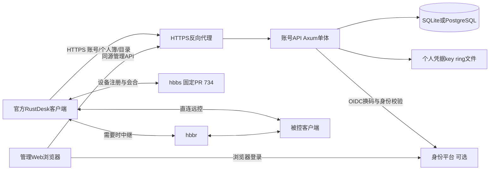
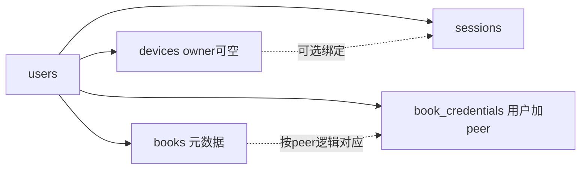

# 技术架构

- `document_status: reviewed`；`architecture_status: implemented_schema4`；版本：0.12；整理：2026-11-03。
- 负责人：项目发起人；需求来源：[PRD](PRD.md)；决策理由：[技术路线](technical-route.md)。
- 本文描述当前本地实现与已记录的部署结构。线上事实以2026-10-31快照为依据，不代表本次重新巡检。[早期讨论稿](architecture-discussion-2026-10-31.md)单独归档。

## 系统边界

账号API保存账号、会话、个人簿、凭据密文、归属及审计。`hbbs`负责会合，`hbbr`负责中继；屏幕、键鼠和文件内容不经过账号API。账号数据库与hbbs自己的SQLite及服务器签名密钥分开，不直接改写hbbs内部表实现业务。

API权限保护账号数据和目录。设备归属不等于远控授权；远控仍需要目标端既有密码或确认机制。PR #734提供登录后的信令握手兼容，不验证本API的用户角色或实现远控ACL。账号退出/停用不承诺切断已经建立的远控。

## 部署单元

| 单元 | 组成 | 持久化或依赖 |
|---|---|---|
| 账号API | 一个Rust进程，HTTP路由、业务、静态Web和后台审计保留任务 | 选择一种账号数据库、Web构建目录；启用凭据同步时挂载key ring |
| 管理Web | Vue构建的静态文件，在`/admin/`由Axum提供 | 浏览器同源请求，Web会话Cookie和内存CSRF值 |
| HTTPS入口 | 通用部署使用Caddy；既有实例使用Traefik | 域名、证书、受控的外部origin |
| 数据库 | SQLite或PostgreSQL二选一 | 独立账号库；生产实例的共享PG由PG维护入口统一备份 |
| OIDC IdP | 可选的一个提供方 | issuer、client、固定回调和静态角色策略；当前生产未启用 |
| RustDesk服务 | hbbs与hbbr独立容器/Compose项目 | 原服务器身份和peer数据；PR构建只替换hbbs |

当前为单实例服务。共享PG不自动提供多实例支持：OIDC未完成尝试和登录限流保存在进程内，需要跨实例协调才能扩展。暂不引入分布式缓存、队列或自动故障转移。

## 代码模块与调用方向

[main.rs](../api/src/main.rs)解析配置、连接数据库并迁移、加载凭据密钥、准备OIDC/Web与限流、检查就绪，然后合并路由并监听。所有CLI也通过`Store::connect`进入迁移流程，维护命令不能被当成对旧数据库纯只读检查。

| 位置 | 当前职责 |
|---|---|
| [compat.rs](../api/src/compat.rs) | 官方客户端DTO、状态码、认证、Legacy个人簿和目录适配 |
| [web_auth.rs](../api/src/web_auth.rs) | Web登录、Cookie/CSRF/Origin、本人资料与会话、Web OIDC适配 |
| [admin.rs](../api/src/admin.rs) | 管理员用户、会话、设备、审计路由，复用WebAuth |
| [oidc.rs](../api/src/oidc.rs) | 提供方发现、授权码/PKCE校验、短期Attempt、角色输入和回调/轮询 |
| [store.rs](../api/src/store.rs) | 账号、身份映射、会话、簿、设备、权限复核、事务和两库方言；当前业务核心集中于此 |
| [credentials.rs](../api/src/credentials.rs) | key ring加载、AES-GCM及用户/peer绑定验证 |
| [audit.rs](../api/src/audit.rs) | 固定审计事件和查询，由store作为子模块引入 |
| [limits.rs](../api/src/limits.rs) | client/Web共用的进程内登录限流 |
| [operations.rs](../api/src/operations.rs)、[web_files.rs](../api/src/web_files.rs) | 存活/就绪、请求日志、安全静态资源提供 |
| [web/src](../web/src/) | 主页面、账号/会话、审计和设备面板，复用同源API客户端 |

实际依赖为路由/身份适配 → Store事务 → SQLx数据库。管理路由的前置鉴权不能替代Store事务内对当前Web会话和角色的再次检查。当前是按模块划分的单体，尚未拆分成独立领域服务或多个可部署后端。

## 数据模型

| 表或状态 | 所有权与作用 |
|---|---|
| `users` | 本地账号或OIDC身份；保存来源、角色、准入/停用等状态，OIDC以issuer+sub识别 |
| `sessions` | 用户的client/Web用途会话，保存token摘要、有效/撤销状态；可关联设备 |
| `books` | 每用户一整本个人簿元数据快照 |
| `book_credentials` | 按用户+peer保存key ID、nonce、凭据密文，不将hash混进元数据快照 |
| `devices` | 登录关联的设备材料与可空owner；独立于个人簿联系人 |
| `audit_events` / `device_events` | 账号审计与设备归属事件，两类记录分别维护 |
| `settings` | 初始化与OIDC策略版本等持久状态 |
| `account_schema_migrations` | 已执行的迁移台账 |
| OIDC Attempt / 登录限流 | 仅进程内短期状态，不是数据库表或持久化会话 |

此图表示业务关系；个人簿peer不要求是受管设备，`book_credentials.peer_id`不是`devices`外键。用户、簿、密文和设备的具体读写/删除策略见[业务逻辑](logic.md)。

两套迁移位于[SQLite](../api/migrations/sqlite/)与[PostgreSQL](../api/migrations/postgres/)，由Store引入并顺序执行，不是直接运行SQLx目录迁移器。当前schema4保留旧账号/簿/会话，新增设备及凭据；旧会话不猜测回填设备。数据库降级采用旧镜像配合升级前快照，不让旧schema3二进制直接打开新库。

## 身份、安全与数据流

客户端采用Bearer随机token，Web采用独立用途的HttpOnly Cookie；数据库保存应用token的摘要，不把IdP JWT直接当本服务token。每次受保护操作复核当前会话与用户状态，写事务再次处理权限与并发失效边界。

账号密码由Argon2保存；OIDC外部账号不生成本地密码。个人簿hash是可用于远控认证的派生凭据，采用AES-256-GCM静态加密，AAD绑定用户、peer与key ID。API持钥向同一账号客户端返回hash，因此必须使用HTTPS，且不是端到端加密。

个人簿按整本快照原子替换，元数据与密文同事务提交，最后数据库成功提交生效，不做冲突合并。Web写操作校验受控Origin和CSRF。请求日志记录路由模板、状态、耗时，不记录原始URI或凭据；审计使用固定事件结构。

## 运维与变更边界

`/healthz`表示进程存活，`/readyz`检查Web产物、schema和可写路径。缺少Web构建、迁移失败或存量密文无法解密时，服务拒绝启动/操作，不降级为空数据。服务支持信号优雅停机和有界审计清理。

运维具体步骤由[运维手册](operations.md)和[部署操作](../deploy/README.md)维护，支持范围由[发布与支持矩阵](release-notes.md)维护。版本变化先判断影响账号API、客户端兼容还是hbbs/hbbr，按对应路径检查，不因一次改动重复全部历史验收。
