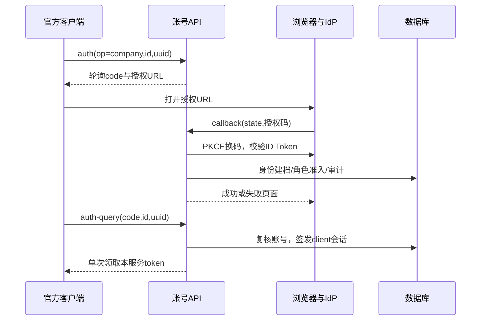
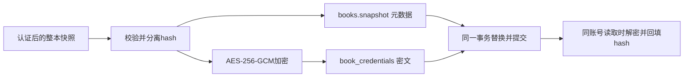

# 业务逻辑与数据规则

- `document_status: reviewed`；`business_logic_status: implemented_with_recorded_validation`。
- 整理日期：2026-11-03；实现事实来自当日本地源码与迁移的静态核对，本次未运行功能测试或检查线上。
- 负责人：项目发起人；源码一致性整理：Codex；文档契约见[任务简报](assets/document-brief.md)。
- 需求唯一来源为 [PRD](PRD.md)，本文解释现有规则，不新增产品承诺；接口参数和默认值查 [API README](../api/README.md)，部署操作查[运维文档](operations.md)及[部署手册](../deploy/README.md)。
- 历史运行状态：2026-10-31已完成 schema4 实例升级；固定 PR #734 的 hbbs 部署后，用户确认 Mac 登录后远控成功、Windows 同步后免输密码成功。仅适用于记录中的官方 1.5.0 测试设备，证据见[升级记录](device-credentials-deployment-2026-10-31.md)和[握手兼容记录](rendezvous-compatibility.md)。

## 1. 规则边界与事实归属

本服务为单团队提供账号、会话、个人簿与设备目录。官方客户端通过兼容 API 使用服务，浏览器通过独立管理 API 操作；两者共用账号与数据库，凭据用途分开。SQLite 与 PostgreSQL 执行同一业务规则，方言迁移各自维护。

个人簿是用户收藏的远端条目；设备目录是认证登录形成、管理员可维护的归属记录。收藏某设备不要求拥有它，拥有设备也不会自动把它加入个人簿。个人簿的 `peer_id` 与目录的 RustDesk ID 没有数据库外键关系。

归属、目录可见性、API 会话与远控密码是不同边界。用户已取消按用户、用户组限制远控；服务不建立团队共享簿、用户组或远控 ACL。固定 PR #734 解决登录后的 hbbs 握手兼容，不增加账号 token 校验。退出或撤销 API 会话不能断开已经建立的远控。

本文的表结构及规则属于 `implementation_fact`；PRD 用户决策属于 `confirmed_fact`；2026-10-31 的部署和人工结果属于历史 `runtime_observation`。旧调研中的“尚未实现”应结合其证据时间理解，不能覆盖现有实现。

## 2. 身份与账号生命周期（RD-002～006、RD-018～019）

### 2.1 本地账号

没有内置默认账号或公开自助注册。首次管理员通过可信 CLI `bootstrap-admin` 初始化；成功创建本地管理员会持久设置 `settings.bootstrap_initialized=1`，不能重复使用初始化入口。迁移旧库发现本地管理员时同样关闭该入口。离线恢复使用可信 `create-local`，不绕过数据库与宿主机权限。

管理员 Web 可创建 `admin/member` 本地账号、启停所有来源账号、调整本地角色、重置本地密码；成员可修改自己的本地密码。用户名必须非空、无首尾空白、最多128字节；密码12～4096字节，使用随机盐 Argon2 保存。修改密码要求当前密码，管理员重置不要求目标旧密码。

账号同时有三个状态维度：`role` 决定管理员/成员能力，`disabled` 表示人工停用，`admitted` 表示当前准入。会话只能用于 `disabled=0 AND admitted=1 AND role IN ('admin','member')` 的账号；OIDC失去准入时可保留 `role=''` 的不可用档案。

人工停用保留账号、个人簿和设备归属，并撤销全部会话；重新启用本地账号恢复准入。最后一个有效本地管理员不能被停用或降级；保护条件为来源 local、admin、未停用且已准入。OIDC真实降权不受这一保护，应保留独立本地应急管理员。

定位：[store.rs](../api/src/store.rs) 的 `bootstrap_admin`、`insert_local`、`validate_credentials`、`admin_update_user`、`protect_last_admin`、`change_password`、`admin_reset_password`；[accounts迁移](../api/migrations/sqlite/0002_accounts.sql)。

### 2.2 OIDC身份与JIT建档

仅支持配置的单个 OIDC provider。外部身份使用已验证 ID Token 的 `(issuer, subject)` 唯一识别，不按邮箱、显示名或同名本地账号合并。首次验证后生成内部 UUID 和 `oidc-{UUID}` 用户名，创建空个人簿；显示名依次选 `name`、`preferred_username`、`sub`，显示名不承担身份绑定。

认证成功但准入失败时仍可保留不可用身份档案和审计，不签发可用会话。重复登录重用原身份；每次成功完成 IdP 身份验证后重新计算角色、准入和显示名。用户被本地停用后，匹配角色也不能重新启用；管理员重新启用 OIDC 用户时仍置为未准入，必须再次通过 IdP 登录。

OIDC账号没有本地密码；本地改密/重置与手工角色变更返回冲突，密码由 IdP 管理，角色由准入策略管理。服务没有 IdP 事件推送同步；IdP侧角色变化通常在下次 OIDC 登录时生效。

定位：[store.rs](../api/src/store.rs) 的 `find_or_create_oidc`、`admin_update_user`；[oidc.rs](../api/src/oidc.rs) 的 `OidcService::complete`。

### 2.3 单claim角色规则

读取签名 ID Token 扩展字段中的单一路径，可用点分隔嵌套对象；不读取未验证的客户端声明或任意目录结果。值只接受字符串或全为字符串的数组，采用大小写敏感的完整值匹配。

| claim结果 | 准入与角色 |
|---|---|
| 任一值匹配配置的admin值 | `admin`，优先于member |
| 无admin匹配，任一值匹配member值 | `member` |
| 路径缺失或值无匹配 | 默认拒绝；仅显式配置允许时兜底为member |
| 路径中间类型错误、末端非字符串/字符串数组 | 拒绝；即使启用member兜底也不准入 |
| 签名、issuer、audience、nonce等认证失败 | 拒绝，不进入角色兜底 |

没有 admin 兜底、表达式、多claim组合或额外目录查询。失去准入或 admin→member 会撤销该用户全部既有 client/Web 会话；升权更新账号状态，既有会话鉴权读取当前角色。

配置规范化后计算策略版本。启动时版本变化会撤销所有 OIDC 用户会话；关闭 OIDC 也会同步独立的禁用版本。配置变更采用单实例停机重启，进行中的内存登录状态随重启丢失，不支持跨配置并行实例滚动变更。

定位：[oidc.rs](../api/src/oidc.rs) 的 `mapped_role`、`policy_version`；[store.rs](../api/src/store.rs) 的 `find_or_create_oidc`、`sync_policy_version`；[main.rs](../api/src/main.rs) 的 OIDC 初始化分支。

## 3. 登录、会话与撤销（RD-004～005、RD-011、RD-017）

### 3.1 本地登录与会话用途

client 登录要求 `type=account`，成功返回本服务 `access_token/type/user`；`user.info` 保留空对象以满足官方解析。Web 本地登录要求正确 Origin，成功设置 Cookie并返回用户与 CSRF 值。两条入口共用进程内账号/总量限流，统计登录尝试，不依赖代理IP头；重启会重置限流状态。

密码验证在阻塞工作线程运行，昂贵计算放在写锁外；进入写事务后复核验证过的精确密码散列及当前账号状态，防止密码刚被重置又用旧验证结果发会话。

会话 token 为32随机字节的十六进制串，数据库仅存 SHA256 摘要；公开会话 UUID 用于管理与审计，不是凭据。`sessions.kind` 分为 `client/web`，API不允许互换。会话有固定到期时间；鉴权同时检查用途、未撤销、未到期及当前账号准入/停用/角色，服务重启后可继续验证数据库中的有效会话。

Web使用host-only、HttpOnly、SameSite=Lax Cookie，路径限定为 `/admin/api/v1`，HTTPS时带Secure。Web受保护写操作同时验证 Origin 和 `X-CSRF-Token`；登录与发起OIDC在尚无会话时检查 Origin。CSRF值绑定当前会话，`GET /me`可重新取得，不返回原始token或摘要。

定位：[compat.rs](../api/src/compat.rs) 的 `login`、`authenticated`、`user_payload`；[web_auth.rs](../api/src/web_auth.rs) 的 `WebAuth::authenticate`、`session_cookie`、`csrf_token`；[store.rs](../api/src/store.rs) 的 `finish_local_login_with_device`、`insert_session`、`authenticate_kind`；[limits.rs](../api/src/limits.rs) 的 `LoginLimiter`。

### 3.2 OIDC浏览器回调与客户端轮询

授权码流程使用 PKCE S256、state、nonce。库验证签名、issuer、audience、有效期及nonce；有 `at_hash` 时验证access token hash；多audience要求 `azp`，存在 `azp` 时必须等于本服务client ID。对外请求验证传输地址且不跟随重定向，测试用loopback HTTP必须显式允许。

轮询code与IdP授权码不同。客户端尝试绑定发起时的 `id/uuid`，等待返回官方识别的 `No authed oidc is found`；完成或失败结果只能消费一次。回调state在换码前单次消费。尝试仅保存在进程内，180秒过期且数量有界，重启后需重试。

Web复用身份校验与映射，但用临时 HttpOnly Cookie绑定浏览器；成功回调直接签发web会话并跳转管理页，页面和重定向URL不携带会话token。客户端成功结果在轮询领取时再次检查当前账号状态，不能依赖回调时的旧用户快照。

定位：[oidc.rs](../api/src/oidc.rs) 的 `Attempts::take_callback`、`Attempts::poll`、`start`、`poll`、`callback`、`OidcService::start_web`、`OidcService::complete`。

### 3.3 撤销效果

| 触发 | 撤销范围与保留内容 |
|---|---|
| client/Web正常退出 | 当前对应用途会话；保留簿和设备归属 |
| 本人或管理员选择会话UUID撤销 | 该会话；普通成员只能撤销本人会话 |
| 本人全部退出或管理员撤销目标全部会话 | 目标用户全部client/Web会话 |
| 本地改密、管理员重置密码 | 全部既有会话，包括当前改密会话 |
| 停用、OIDC失去准入、admin降为member | 目标用户全部会话 |
| OIDC策略版本变化 | 所有OIDC用户既有会话，本地账号会话保留 |
| 管理员分配/解除设备 | 绑定该设备的所有未撤销client会话；Web会话保留 |

会话撤销只约束后续服务端请求，不保证擦除离线客户端缓存、回收已下载hash或终止已有远控。本地退出失败/超时不能视为服务端已撤销。旧未绑定设备的会话需按公共会话ID或用户整体撤销。

定位：[store.rs](../api/src/store.rs) 的 `logout_session`、`revoke_managed_session`、`revoke_user_sessions`、`revoke_sessions_tx`、`assign_device`。

## 4. 个人簿快照与连接凭据（RD-007～008、RD-020）

### 4.1 协议与覆盖规则

认证后的 `POST /api/ab/personal` 有意返回404，让官方客户端回退Legacy；无效会话仍返回401。`GET/POST /api/ab` 的外层 `data` 是JSON字符串，内层是 `peers/tags` 快照；读取附带 `licensed_devices=0`。

只保留peer ID、alias、platform、username、hostname、tags以及顶层tags/tag_colors。原文 `password`、未知字段被剔除；`hash`仅在启用凭据同步时按专门规则接收。每本最多1000个peer、1000个标签；重复/空/超长ID、非法字段或超限会拒绝整次上传。请求体上限等完整协议约束查 [API README](../api/README.md)。

每用户一个整本快照，最后成功提交生效，不合并字段、不做增量、版本冲突提示或乐观锁。旧离线快照可能覆盖较新的条目和凭据。非法上传不覆盖原簿；空簿是有效快照，代表清空。事务内重新验证有效client身份并由该身份选簿，不采信用于指定他人归属的请求字段。

定位：[compat.rs](../api/src/compat.rs) 的 `personal_probe`、`address_book_snapshot`、`read_book`、`write_book`；[store.rs](../api/src/store.rs) 的 `get_book_authenticated`、`put_book_authenticated`。

### 4.2 hash与密文规则

官方个人簿 `hash` 是目标密码结合salt的SHA256摘要，可参与远控认证，属于可用凭据。服务不获取目标原文密码，不能再把该摘要单向散列而仍保持协议。只接收标准base64编码的32字节hash，兼容规范的有/无padding形式；启用同步时非法非空hash拒绝整簿。目标密码或salt改变会使旧hash失效。

配置有效key ring才启用同步；未配置且数据库无密文时运行metadata-only模式。写入响应通过 `x-rustdesk-credential-sync` 声明 `enabled; personal-salted-hash` 或 `disabled; metadata-only`。仅客户端已放入个人簿并记住成功连接密码的条目走此同步路径，最近连接记录不等于已收藏条目。

AES-256-GCM使用随机96位nonce，AAD按长度编码版本、user ID、peer ID、key ID。`books.snapshot`剥离hash/password，`book_credentials`仅存key ID、nonce与密文。API持有解密钥匙并经HTTPS回传同账号客户端，属于服务端静态加密，不能称为端到端加密。

启动校验全部存量密文；读取和写入再次验证相关密文。缺钥、错钥或篡改直接失败，不返回空簿，也不允许通过空快照悄悄清除不可解密密文。元数据替换、旧凭据删除与新密文插入同事务完成，任一步失败保留旧数据。

遗漏/清空hash、删除peer或清空簿都会删除对应密文。新写入使用active key；旧密钥保留时仍可读旧密文，没有后台全库重加密。恢复需要匹配的数据库与key ring；丢失密钥无法恢复凭据，旧备份也可能依赖旧key。文件格式、轮换和核验操作见[凭据设计](device-credentials-design.md)与[运维文档](operations.md)。

定位：[credentials.rs](../api/src/credentials.rs) 的 `CredentialCipher::from_file`、`validate_hash`、`seal`、`open`、`credential_aad`；[store.rs](../api/src/store.rs) 的 `configure_credential_cipher`、`get_book_tx`、`put_book_tx`、`strip_book_secrets`。

## 5. 设备归属、目录与权限（RD-021～022）

client本地登录可携带 `id/uuid/deviceInfo`，OIDC轮询领取会话时提供 `id/uuid`。这些是认证后提交的自报材料，不构成密码学设备证明；不通过匿名sysinfo/heartbeat认领。Web登录不关联设备，旧schema3会话不猜测回填 `device_id`，需重登。

| 登录材料对应状态 | 行为 |
|---|---|
| id与uuid首次出现且格式有效 | 新建设备，归当前用户，绑定本次client会话 |
| 同一uuid、同一owner、id未被其他记录占用 | 允许更新RustDesk ID，保留设备内部ID |
| id属于其他uuid、owner为其他人或id/uuid命中不同记录 | 跳过关联，仍允许账号登录，不夺取归属 |
| 已解除归属、同id/uuid重新登录 | 可绑定会话/更新登录信息，但不自动设置owner，需管理员分配 |
| 缺失、超长、含控制字符等无效材料 | 跳过设备关联，账号仍可登录 |

已有设备的空platform/name/type不会擦除原信息；`last_login_at`仅表示最近成功关联登录时间。归属转移/解除保留设备、个人簿和Web会话，事务内同时撤销全部绑定该设备的client会话并插入 `device_events`；即使指定原owner也执行此撤销流程。

client目录要求client Bearer：`device-group/accessible`返回空组，`users`只返回当前用户，`peers`分页返回本人归属设备，admin客户端也不获得全量目录。peer响应使用RustDesk ID，note来自alias，`status=1`仅表示有效目录项，不代表在线。目录不返回设备UUID，也不提供额外 `/api/my-devices` 接口。

Web成员只能看本人设备；Web管理员可看全部（含未分配设备）并按内部设备ID指定owner或解除，写入同时检查管理员、Origin、CSRF。当前HTTP设备修改只接受 `owner_user_id`；`Store::set_device_alias` 虽存在并记录alias事件，尚无对应HTTP编辑入口，不应据此宣称页面支持改别名。

定位：[store.rs](../api/src/store.rs) 的 `associate_device_tx`、`list_devices`、`assign_device`、`set_device_alias`；[compat.rs](../api/src/compat.rs) 的 `directory_users`、`directory_peers`、`directory_page`；[admin.rs](../api/src/admin.rs) 的 `DeviceAssignment`、`assign_device`。

## 6. 持久化关系与事务（RD-008、RD-012、RD-016）

| 表 | 主键/唯一关系与用途 |
|---|---|
| `users` | 内部UUID主键；username唯一；issuer+subject唯一；local必须有密码散列，oidc必须有issuer/subject且无本地密码 |
| `sessions` | digest主键，公共id唯一；user_id→users删除级联；device_id→devices可空、删除置空；kind、创建/到期/撤销状态 |
| `books` | user_id主键且→users删除级联；每人一个JSON元数据快照 |
| `book_credentials` | (user_id,peer_id)复合主键；user_id→users删除级联；peer_id不引用devices |
| `devices` | 内部UUID主键；rustdesk_id与uuid分别唯一；owner_user_id→users可空、删除置空；设备信息、alias、最近登录 |
| `device_events` | 自增id；actor/device外键必填，旧/新owner外键可空；assign/unassign/alias及撤销数量 |
| `audit_events` | 自增id；主体/目标/公共会话ID为可空文本，无相应外键；封闭事件字段与筛选索引 |
| `settings` | key主键；policy_version提供策略版本及事务串行化锁点，bootstrap_initialized关闭重复初始化 |
| `account_schema_migrations` | version主键；由Store迁移器创建和维护，当前版本4 |

两库迁移分别位于 [SQLite迁移](../api/migrations/sqlite/)和[PostgreSQL迁移](../api/migrations/postgres/)，由[store.rs](../api/src/store.rs)的常量 `include_str!` 引入，`Store::migrate`依次应用0001～0004。迁移加数据库锁并记录版本；遇到比二进制更新的schema拒绝启动，不做降级迁移。schema4新增设备/密文/设备事件与可空会话设备绑定，不回填历史设备。

`Store::write_transaction`通过更新policy_version行串行化业务状态转换；PostgreSQL用行锁，SQLite先取得写锁。授权写操作在该事务内复核操作者；个人簿读写也在同一事务复核client身份，避免先停用后仍用延迟验证结果写入。该机制不等同容量或高可用承诺。

## 7. 账号审计与保留（RD-010）

账号创建/初始化、OIDC建档和映射、策略变化、登录成功/失败、退出、启停、改密/重置、会话撤销使用封闭审计动作和原因码。成功账号/密码/会话/准入/策略变更与审计同事务提交；审计失败会使对应变更失败并回滚，不返回虚假成功。

事件记录时间、内部主体/目标ID、公共会话UUID、认证来源、入口、结果、固定原因码、角色/准入/停用前后状态、策略版本、实际新撤销数量。未知主体登录失败不保存原始用户名；模型无密码、hash、token/摘要、OIDC code/state/nonce/claims/subject、IP或任意metadata字段。请求日志仅记录路由模板、方法、状态与耗时，不记录原始URL查询、头、体或IP。

仅Web管理员可查询账号审计；按ID倒序游标分页，并可筛选时间、主体、目标及封闭分类。设备归属事件独立存 `device_events`，不混入账号审计接口；当前没有设备事件查询API。个人簿内容、远控连接和文件传输也不在账号审计范围。

在线账号审计默认保留90天，可设0关闭自动清理；周期清理有每批及每轮上限，严格删除早于cutoff的记录。非空清理批次同事务记录prune事件，空批次不制造事件。此策略只作用于 `audit_events`，未覆盖device_events、会话行或历史备份；不承诺这些数据已有统一自动保留策略。

定位：[audit.rs](../api/src/audit.rs) 的 `AuditWrite`、`AuditEvent`、`AuditFilter`；[store.rs](../api/src/store.rs) 的 `audit_tx`、`list_audit_events`、`prune_audit`；[main.rs](../api/src/main.rs) 的retention维护任务；[operations.rs](../api/src/operations.rs) 的 `log_request`。

## 8. 端点分组与异常边界

| 分组 | 入口与边界 |
|---|---|
| 客户端账号 | `/api/login`、`/api/currentUser`、`/api/logout`；后两者要求client Bearer，成功对象由compat适配 |
| OIDC | `/api/login-options`声明能力；启用时提供 `/api/oidc/auth`、`auth-query`、`callback`；过程凭据不等于会话 |
| 个人簿 | `/api/ab/personal`探测和 `/api/ab`整本读写；必须有效client身份，不支持团队共享 |
| 客户端目录 | `/api/device-group/accessible`、`/api/users`、`/api/peers`；固定空组与本人范围 |
| Web认证与本人 | `/admin/api/v1/auth/*`、`/me`、`/me/password`；Cookie、Origin与CSRF规则见第3节 |
| Web管理 | 同前缀 `/users`、`/users/{id}`、密码、会话、设备与审计；按管理员/本人权限逐项授权 |
| 探针 | `/healthz`仅存活；`/readyz`检查schema4、数据库写路径和Web产物，失败503 |

账号领域错误统一映射为400非法输入、401未认证、403越权、404目标不存在、409状态冲突；无法分类的存储/密文异常返回通用500，不泄露内部错误。OIDC部分失败路径在审计不可用时返回503，回调页面不展示IdP内部错误。JSON解析、请求体上限等由框架拒绝，不保证每类框架拒绝都产生登录审计。

只有兼容协议有意定义的空设备组、未启用登录选项及认证后Legacy探测404属于正常能力响应。数据库失败、无效身份或密文损坏不能伪装成空列表/空簿。目录分页不合法返回400；过期/重放OIDC尝试失败后必须重新开始登录。

定位：[compat.rs](../api/src/compat.rs) 的 `router_with_limiter`、`internal`；[web_auth.rs](../api/src/web_auth.rs) 的 `account_error`；[admin.rs](../api/src/admin.rs) 的 `router`；[operations.rs](../api/src/operations.rs) 的 `ready`、`readiness`。

## 9. 维护时的验证入口与剩余边界

| 需求ID/规则 | 可观测验证入口（本次仅静态核对） |
|---|---|
| RD-002～006、009、011 | [admin测试](../api/tests/admin.rs)、[web_auth测试](../api/tests/web_auth.rs)：管理员保护、用途隔离、Cookie/CSRF、改密撤销 |
| RD-007～008、020 | [synchronization测试](../api/tests/synchronization.rs)、[book_credentials测试](../api/tests/book_credentials.rs)、[credentials_http测试](../api/tests/credentials_http.rs)：整本原子覆盖、隔离、缺/错钥失败 |
| RD-017～019 | [oidc.rs内测试](../api/src/oidc.rs)与[既有验证入口](../validation/README.md)：claim类型、映射、回调/轮询与真实Keycloak |
| RD-021～022 | [device_storage测试](../api/tests/device_storage.rs)、[devices_http测试](../api/tests/devices_http.rs)：冲突、归属转移、会话撤销和目录隔离 |
| RD-010、012、016 | [audit测试](../api/tests/audit.rs)、[audit_api测试](../api/tests/audit_api.rs)及两库迁移：审计失败回滚、游标、保留与升级 |

上述需求归属仍由PRD及任务简报指定的项目负责人负责，源码和测试是维护下游，不以本次文档整理替代验收。2026-10-31人工结果覆盖本次Mac/Windows设备；生产OIDC、完整平台矩阵、自动JWKS刷新、IdP事件同步、客户端最终退出/配置恢复等边界仍按[维护计划](maintenance.md)与原验收记录处理。JWKS随初始化Discovery加载，刷新需重启；不能推断IdP角色或密钥变化已即时同步。
